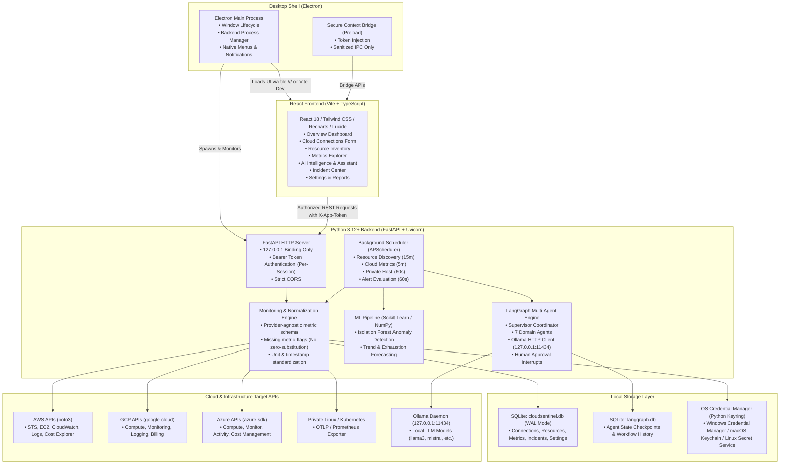

# CloudSentinel AI — Architecture Specification

## 1. System Vision & Principles

**CloudSentinel AI** is a professional, local-first unified multi-cloud infrastructure monitoring, AI-based anomaly detection, predictive analytics, and intelligent incident response desktop application.

### Core Architectural Principles:
1. **Local-First & Zero Hosted Dependencies**: All metrics, incidents, logs, investigations, and configuration data remain strictly on the user's local machine. No Supabase, Firebase, cloud databases, user registration, or authentication servers.
2. **Unified Multi-Cloud Observability**: Native, first-class support for Amazon Web Services (AWS), Google Cloud Platform (GCP), Microsoft Azure, and private Linux servers via Prometheus/OpenTelemetry Collector.
3. **True Anomaly Detection & Predictive ML**: Real Scikit-learn (Isolation Forest) and time-series forecasting (autoregressive moving averages / trend extrapolation), rejecting synthetic or hardcoded metrics.
4. **Local AI Engine via Ollama & LangGraph**: Local multi-agent supervisor architecture powered by locally running Ollama models (e.g., Llama 3, Mistral, Qwen) with SQLite checkpointing and human-in-the-loop remediation gates.
5. **Defense-in-Depth Local Security**: Per-session dynamic API token authentication, 127.0.0.1 binding only, context isolation, hardened preload scripts, and operating system keyring storage for cloud credentials.

---

## 2. High-Level System Architecture



---

## 3. Five Core Services

### Service 1: Electron Desktop Shell
* **Location**: `desktop/`
* **Responsibilities**:
  - Initializes the desktop window (`BrowserWindow`) with strict security headers.
  - Generates a cryptographically strong UUID4 `app_token` on every application boot.
  - Spawns the local Python backend process as a child process, passing the token via standard input or environment variable, and checks readiness on `/api/v1/health`.
  - Enforces `contextIsolation: true`, `nodeIntegration: false`, `sandbox: true`, and `webSecurity: true`.
  - Exposes safe, typed IPC APIs to the preload script (window controls, app version, native desktop notifications).
  - Handles graceful backend termination (`SIGTERM` followed by `SIGKILL` if unresponsive) on app exit.

### Service 2: React Frontend
* **Location**: `frontend/`
* **Tech Stack**: React 18, TypeScript, Vite, Tailwind CSS, Lucide React, React Router 6, TanStack Query 5, Recharts.
* **Responsibilities**:
  - Modern, responsive enterprise dark-mode/light-mode dashboard.
  - Multi-provider resource inventory with live filtering, sorting, and pagination.
  - Interactive multi-metric time series charts with normalized units and missing metric badges.
  - Natural-language conversational AI assistant connected to the local LangGraph supervisor.
  - Incident investigation center displaying root-cause analyses, evidence chains, and human-in-the-loop approval buttons for safe remediation.
  - Real-time notification banners and audio/visual alerts.

### Service 3: Local Python Backend
* **Location**: `backend/app/`
* **Tech Stack**: Python 3.12+, FastAPI, Uvicorn, SQLAlchemy 2.0 (asyncio + aiosqlite), Pydantic v2.
* **Responsibilities**:
  - Bound strictly to `127.0.0.1:8765` (or dynamic free port).
  - Validates `X-CloudSentinel-Token` on every non-health endpoint.
  - Provides RESTful routes for connections, inventory, metrics, incidents, ML anomaly detection, LLM chat, remediation actions, reports, and configuration.
  - Maintains SQLAlchemy ORM models with SQLite foreign keys and WAL mode.

### Service 4: Background Monitoring Worker
* **Location**: `backend/app/workers/`
* **Tech Stack**: APScheduler (BackgroundScheduler / AsyncIOScheduler), asyncio.
* **Responsibilities**:
  - Independent collection loop that continues running irrespective of frontend navigation.
  - Scheduled jobs:
    * Resource discovery: every 15 minutes.
    * Cloud provider metrics: every 5 minutes.
    * Private Linux server metrics: every 60 seconds.
    * Alert rule evaluation: every 60 seconds.
    * ML anomaly scoring: runs after each collection cycle.
    * Data retention cleanup: daily.
  - Prevents overlapping job execution (`max_instances=1`, `coalesce=True`).
  - Exponential backoff and jitter on cloud API throttling / rate limiting.

### Service 5: Local AI Engine (LangGraph + Ollama)
* **Location**: `backend/app/agents/`
* **Tech Stack**: LangGraph, LangChain Core, `langchain-ollama`, `langgraph-checkpoint-sqlite`.
* **Responsibilities**:
  - Verifies local Ollama daemon status (`http://127.0.0.1:11434/api/version` and `/api/tags`).
  - Implements a Supervisor Coordinator agent orchestrating 7 specialized subagents:
    1. Infrastructure Monitoring Agent
    2. Anomaly Detection Agent
    3. Predictive Analysis Agent
    4. Log Analysis Agent
    5. Security Intelligence Agent
    6. Root Cause Analysis Agent
    7. Safe Remediation Agent (with human approval gate)
  - Persists workflow state in `langgraph.db` with strict deserialization.
  - Gracefully degrades when Ollama is offline (alerts and ML remain fully operational).

---

## 4. Storage Architecture

```
%LOCALAPPDATA%/CloudSentinelAI/ (Windows)
~/.local/share/cloudsentinel/ (Linux)
~/Library/Application Support/CloudSentinel/ (macOS)
├── cloudsentinel.db          # Main SQLite database (WAL mode)
├── cloudsentinel.db-wal      # WAL journal
├── cloudsentinel.db-shm      # Shared memory
├── langgraph.db              # Separate SQLite database for agent checkpoints
├── models/                   # Persisted Scikit-learn models (IsolationForest)
├── reports/                  # Generated PDF/CSV/JSON reports
├── logs/                     # Application logs (backend.log, electron.log)
└── backups/                  # Database backups (.db.gz)
```

### SQLite Hardening Settings:
```sql
PRAGMA journal_mode = WAL;
PRAGMA synchronous = NORMAL;
PRAGMA busy_timeout = 10000;
PRAGMA foreign_keys = ON;
PRAGMA cache_size = -64000; -- 64MB cache
```

---

## 5. Security & Isolation Matrix

| Boundary | Enforcement Mechanism | Failure Policy |
| :--- | :--- | :--- |
| **Electron -> Renderer** | `contextIsolation: true`, `nodeIntegration: false`, `sandbox: true` | Preload exposes only verified IPC methods |
| **Renderer -> Backend** | `127.0.0.1` binding, `X-CloudSentinel-Token` header validation | HTTP 401 Unauthorized, immediate request drop |
| **Backend -> Secrets** | OS Keyring (Windows Credential Manager / Keychain / Secret Service) | Fallback to PBKDF2-derived AES-256-GCM vault with master password |
| **Agents -> Cloud Write** | Human-in-the-loop interrupt in LangGraph; explicit user approval | Remediation actions default to disabled; require 2-step verification |
| **Agent -> Shell** | Arbitrary shell execution prohibited; allowlisted discrete operations only | Command rejection with security audit log |
| **Ollama Model Access** | Local `127.0.0.1:11434` only; prompt scrubbing removes secret keys | Credentials never forwarded in prompts |
