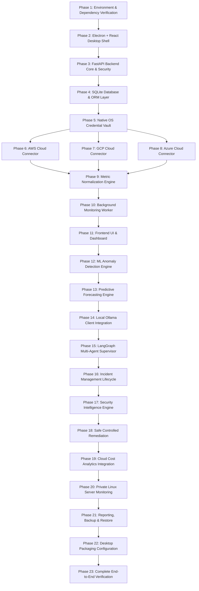

# CloudSentinel AI — Phased Implementation Plan

## Overview
This implementation plan outlines the 23 sequential development and verification phases for **CloudSentinel AI**, ensuring each component is strictly tested, resilient, and adheres to local-first principles.

---

## Phase Breakdown

---

### Phase Details

#### Phase 1: Environment & Compatibility Check
- Verify Python (3.12+ or 3.13), Node.js (v20+), npm, Vite, Electron compatibility.
- Ensure all required packages (FastAPI, SQLAlchemy, boto3, google-cloud, azure-sdk, langgraph, scikit-learn) are installed and importable.
- Document dependency pins in `DEPENDENCY_COMPATIBILITY.md`.

#### Phase 2: Electron + React Desktop Shell
- Initialize `desktop/` with TypeScript, `main.ts`, `preload.ts`, and `backend-manager.ts`.
- Initialize `frontend/` with Vite, React 18, TypeScript, Tailwind CSS, Lucide React, and React Router.
- Configure secure IPC bridge (`contextIsolation: true`, `nodeIntegration: false`).
- Test frontend build and desktop window launch.

#### Phase 3: FastAPI Backend Core & Security
- Implement FastAPI application at `backend/app/main.py` bound strictly to `127.0.0.1`.
- Implement per-session dynamic token middleware (`X-CloudSentinel-Token`).
- Implement CORS whitelist (allowing only desktop shell origins).
- Implement standard health check endpoint `/api/v1/health`.

#### Phase 4: SQLite Database & ORM Layer
- Design SQLAlchemy 2.0 ORM models for all 16 core entities:
  - `cloud_connections`, `cloud_resources`, `infrastructure_metrics`, `resource_metric_aggregates`
  - `alerts`, `incidents`, `incident_investigations`, `remediation_actions`
  - `security_events`, `cost_records`, `collection_jobs`, `user_preferences`
  - `application_settings`, `audit_logs`, `ml_model_metadata`, `cloud_resource_metadata`
- Configure SQLite connection with WAL mode, busy timeout, and foreign key enforcement.
- Provide automatic schema creation and Alembic migration structure.

#### Phase 5: Native OS Credential Vault
- Implement `backend/app/credentials/vault.py` using Python `keyring`.
- Support Windows Credential Manager, macOS Keychain, and Linux Secret Service.
- Implement secure fallback using PBKDF2 HMAC-SHA256 and AES-256-GCM authenticated encryption if keyring is unavailable.
- Provide credential validation, replacement, and secure deletion APIs.

#### Phase 6: AWS Cloud Connector
- Implement `backend/app/cloud/aws/connector.py` via `boto3`.
- Validate credentials via STS `GetCallerIdentity`. Support IAM Role assumption.
- Implement EC2 instance discovery (name, type, state, VPC, IPs, EBS volumes).
- Retrieve CloudWatch metrics (`CPUUtilization`, `NetworkIn`, `NetworkOut`, `DiskReadOps`, `StatusCheckFailed`).
- CloudWatch Logs retrieval and Agent-required memory detection.

#### Phase 7: GCP Cloud Connector
- Implement `backend/app/cloud/gcp/connector.py` via `google-cloud-compute` and `google-cloud-monitoring`.
- Support Service Account JSON key loading and ADC validation.
- Discover Compute Engine instances (machine type, zone, status, internal/external IPs, labels).
- Query Cloud Monitoring time series for CPU, network, and uptime. Support Ops Agent detection.

#### Phase 8: Azure Cloud Connector
- Implement `backend/app/cloud/azure/connector.py` via `azure-identity` and `azure-mgmt-compute`.
- Validate Service Principal credentials (Subscription ID, Tenant ID, Client ID, Client Secret).
- Discover Virtual Machines, resource groups, regions, VM sizes, power states.
- Query Azure Monitor for `Percentage CPU`, `Network In Total`, `Network Out Total`, and disk metrics.

#### Phase 9: Metric Normalization Engine
- Implement provider-independent unified metric schema (`UnifiedMetricSample`).
- Normalize units (percentages to 0–100%, network/disk rates to bytes/sec).
- Standardize ISO-8601 UTC timestamps.
- Explicitly flag missing/unsupported metrics as `None` (preventing zero-substitution).
- Enforce deduplication and metric validation.

#### Phase 10: Background Monitoring Worker
- Implement APScheduler asynchronous runner with non-overlapping execution locks.
- Scheduled tasks:
  - Resource discovery (every 15 min)
  - Cloud metric pull (every 5 min)
  - Private Linux metric pull (every 60s)
  - Alert rule evaluation (every 60s)
- Retries with exponential backoff on cloud provider throttling.

#### Phase 11: Frontend UI & Dashboard
- Enterprise dark/light interface with modern telemetry aesthetics.
- 12 primary views:
  1. Overview (cluster health, resource counters, provider breakdown, live sparklines)
  2. Cloud Connections (interactive modal wizards for AWS, GCP, Azure, Private)
  3. Resource Inventory (live search, filter by provider/state, metric badges)
  4. Infrastructure Monitoring (multi-resource real-time metrics)
  5. Metrics Explorer (historical charting, metric comparison, CSV export)
  6. AI Intelligence (multi-agent workspace, live reasoning trace)
  7. Incident Center (severity filters, root-cause details, remediation approval)
  8. Security Center (audit events, IAM changes, anomalous IP alerts)
  9. Cost Analytics (provider breakdown, service costs, trends)
  10. Reports (PDF/CSV/JSON report generator)
  11. AI Assistant (conversational assistant grounded in real SQLite metrics)
  12. Settings (Ollama URL, model selection, intervals, DB retention, vault status)

#### Phase 12: ML Anomaly Detection Engine
- Implement Scikit-learn `IsolationForest` pipeline (`backend/app/ml/anomaly.py`).
- Feature extraction: CPU, memory, disk, network, rolling means, standard deviations, rate of change.
- Persistence and versioning of trained models per resource family.
- Output normalized anomaly scores (-1 to +1) with severity classification and evidence breakdown.

#### Phase 13: Predictive Forecasting Engine
- Implement time-series utilization forecasting (`backend/app/ml/forecaster.py`).
- Historical observation requirement checks (flagging `insufficient historical data` when < minimum required points).
- Predict time-to-exhaustion (e.g. disk full within X hours, CPU saturation risk).

#### Phase 14: Local Ollama Client Integration
- Implement local Ollama API client (`http://127.0.0.1:11434`).
- Health check, model enumeration (`/api/tags`), and streaming inference.
- Graceful fallback: UI displays clear offline status and setup instructions (`ollama run llama3`) when Ollama is unavailable without hindering core monitoring.

#### Phase 15: LangGraph Multi-Agent Supervisor
- Implement LangGraph workflow with SQLite checkpointer (`langgraph.db`).
- Configure supervisor coordinating 7 specialized agents:
  1. Infrastructure Monitoring Agent
  2. Anomaly Detection Agent
  3. Predictive Analysis Agent
  4. Log Analysis Agent
  5. Security Intelligence Agent
  6. Root Cause Analysis Agent
  7. Safe Remediation Agent
- Human-in-the-loop interrupt gate before any remediation execution.

#### Phase 16: Incident Management Lifecycle
- Implement complete incident workflow: Detection -> Alert -> Incident -> Investigation -> Root Cause -> Remediation -> Resolution.
- Deduplication of incoming alerts.
- Investigation history and evidence tracking stored in SQLite.

#### Phase 17: Security Intelligence Engine
- Ingest and analyze cloud security events (AWS CloudTrail, GCP Cloud Audit Logs, Azure Activity Logs).
- Detect unauthorized IAM privilege changes, root logins, and abnormal geo-IP access patterns.

#### Phase 18: Safe Controlled Remediation
- Safe remediation framework:
  - Allowed operations strictly whitelisted: Restart approved private Linux service, restart container, trigger notification webhook, recommend cloud resize.
  - Cloud destructive actions (terminate instance, delete volume) strictly forbidden.
  - Require explicit two-step user approval before executing any remediation action.

#### Phase 19: Cloud Cost Analytics Integration
- Integrate optional billing queries (AWS Cost Explorer, GCP Billing Export, Azure Cost Management).
- Display historical expenditure, breakdown by service and region, and freshness indicator.

#### Phase 20: Private Linux Server Monitoring
- Implement Prometheus / OpenTelemetry OTLP ingestion endpoint.
- Support Node Exporter metrics (CPU, RAM, disk partitions, network traffic, load average).
- Management dashboard for private Linux nodes with freshness trackers.

#### Phase 21: Reporting, Backup & Restore
- Implement PDF, CSV, and JSON report generation using ReportLab and Pandas.
- Implement database backup (`.db.gz`), restore validation, and data retention pruning.

#### Phase 22: Desktop Packaging Configuration
- Configure PyInstaller spec for the backend executable (`backend/dist/cloudsentinel-backend.exe`).
- Configure `electron-builder.yml` for Windows NSIS installer, portable builds, and cross-platform targets.
- Pre-flight first-run wizard (checks DB, creates app data directories, tests Ollama).

#### Phase 23: Complete Verification & Testing
- Unit and integration test suites (`pytest` for backend, `vitest` for frontend).
- Verify end-to-end user workflows, API security, and failure resilience.
