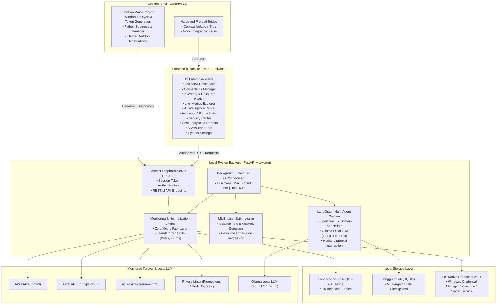

# CloudSentinel AI

> **Local-First Unified Multi-Cloud Infrastructure Monitoring, AI-Based Anomaly Detection, Predictive Analytics, and Intelligent Incident Response Desktop Application.**

[](https://www.python.org/)
[](https://fastapi.tiangolo.com/)
[](https://www.electronjs.org/)
[](https://react.dev/)
[](https://www.sqlite.org/)
[](https://langchain-ai.github.io/langgraph/)
[](https://ollama.ai/)
[](LICENSE)

---

## 🌟 Vision & Key Highlights

**CloudSentinel AI** allows engineers, DevOps teams, and cloud architects to connect multiple cloud providers and monitor infrastructure through a single, responsive desktop interface.

- 🔒 **Zero Hosted Dependencies**: No user registration, no login systems, no Supabase, no Firebase, and no mandatory cloud databases. All telemetry, incident reports, and credentials stay 100% on your local computer.
- 🌐 **Unified Multi-Cloud Observability**: Native, first-class support for:
  - **Amazon Web Services (AWS)** via `boto3` (STS, EC2, CloudWatch, Cost Explorer)
  - **Google Cloud Platform (GCP)** via `google-cloud-compute` and `google-cloud-monitoring`
  - **Microsoft Azure** via `azure-mgmt-compute` and `azure-mgmt-monitor`
  - **Private Linux Servers** via Prometheus and Node Exporter OTLP metrics
- 🧠 **True Machine Learning**: Real Scikit-learn **Isolation Forest** multivariate anomaly detection and predictive time-series resource exhaustion forecasting.
- 🤖 **Local AI via Ollama & LangGraph**: Supervisor coordinating 7 specialized domain agents with SQLite checkpointing and human-in-the-loop remediation gates.
- 🛡️ **Native Credential Security**: Credentials stored in your OS native credential vault (Windows Credential Manager / macOS Keychain / Linux Secret Service) with PBKDF2/AES-256-GCM encrypted fallback.
- 🚀 **High-Throughput SQLite**: Operates with Write-Ahead Logging (`WAL`), strict foreign keys, and isolated `langgraph.db` state persistence.

---

## 🏛️ System Architecture



---

## 💻 Tech Stack

| Component | Technologies |
|---|---|
| **Desktop Shell** | Electron 31, TypeScript, Electron Builder |
| **Frontend** | React 18, Vite 5, TypeScript, Tailwind CSS, Lucide React, React Router 6, TanStack Query 5, Recharts |
| **Backend** | Python 3.12+, FastAPI, Uvicorn, SQLAlchemy 2.0 (asyncio + aiosqlite), Pydantic v2, APScheduler |
| **Database** | SQLite 3 (WAL mode, foreign keys, 20s busy timeout), aiosqlite |
| **AI / Multi-Agent** | LangGraph, LangChain Core, Ollama Local Daemon, SQLite Checkpointer |
| **Machine Learning** | Scikit-learn (Isolation Forest), NumPy, Pandas |
| **Security** | OS Keyring (Windows Credential Manager, Keychain, Secret Service), PBKDF2/AES-256-GCM, loopback binding, session tokens |

---

## 🚀 Getting Started

### 1. Prerequisites
- Python 3.12 or 3.13
- Node.js 18+ (Node 20, 22, 26 supported)
- [Ollama](https://ollama.ai/) installed and running locally on port 11434 (optional, for local AI investigations)

### 2. Backend Setup
```bash
# Clone the repository
git clone https://github.com/cloudsentinel/cloudsentinel-ai.git
cd cloudsentinel-ai

# Install Python dependencies
python -m pip install -r backend/requirements.txt
```

### 3. Frontend & Desktop Setup
```bash
# Build the React frontend
cd frontend
npm install
npm run build

# Build the Electron desktop shell
cd ../desktop
npm install
npm run build:ts
```

### 4. Running the Application
```bash
# Terminal 1: Launch Local Python Backend
python -m uvicorn backend.app.main:app --host 127.0.0.1 --port 8765

# Terminal 2: Launch Desktop Window
cd desktop
npm start
```

---

## 🧪 Testing

Run the comprehensive automated test suite (22 unit, connector, ML, multi-agent, and integration tests):

```bash
python -m pytest -v
```

All tests execute fully offline against local SQLite instances and mocked cloud connectors.

---

## 📖 Documentation Index

- [Architecture Specification](docs/architecture.md)
- [Installation Guide](docs/installation.md)
- [Ollama & Local LLM Setup](docs/ollama-setup.md)
- [SQLite Schema & Database Management](docs/database.md)
- [Local Security & Credential Vault](docs/security.md)
- [AWS Connection Setup](docs/aws-setup.md)
- [GCP Connection Setup](docs/gcp-setup.md)
- [Azure Connection Setup](docs/azure-setup.md)
- [Troubleshooting & FAQ](docs/troubleshooting.md)

---

## 🔒 Security & Privacy

- **100% Local Execution**: All telemetry, logs, investigations, and credentials reside on your device.
- **Zero Plaintext Secrets**: Secrets stored in OS native keyring; references stored as `vault://...`.
- **Human-in-the-Loop**: Destructive operations are prohibited; whitelisted remediations require explicit human approval.
- **Audited Operations**: Every action performed by the user or AI agents is permanently recorded in the local `audit_logs` table.
