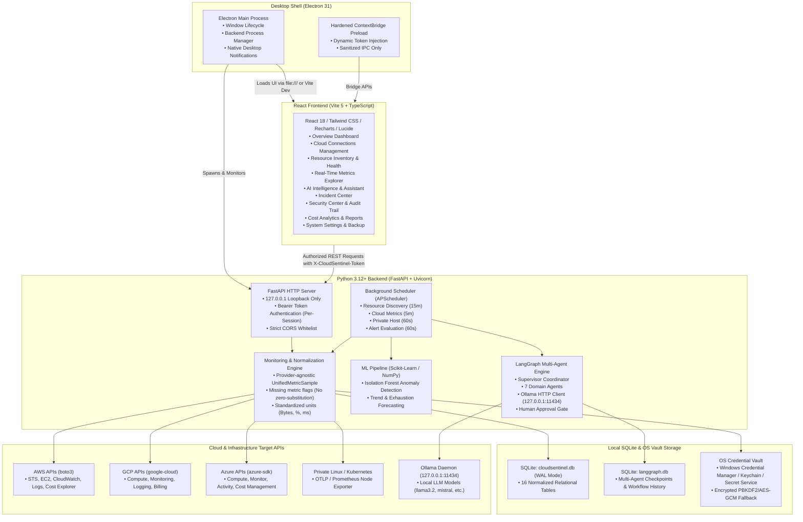

# CloudSentinel AI — Architecture Specification

## 1. System Vision & Core Principles

**CloudSentinel AI** is a professional, local-first unified multi-cloud infrastructure monitoring, AI-based anomaly detection, predictive analytics, and intelligent incident response desktop application.

### Guiding Principles
1. **Local-First & Zero Hosted Dependencies**: All metrics, incidents, logs, investigations, and configuration data remain strictly on the user's local machine. No Supabase, Firebase, hosted cloud databases, user registration, or authentication servers.
2. **Unified Multi-Cloud Observability**: Native, first-class support for Amazon Web Services (AWS), Google Cloud Platform (GCP), Microsoft Azure, and private Linux servers via Prometheus/OpenTelemetry Collector.
3. **True Anomaly Detection & Predictive ML**: Real Scikit-learn (Isolation Forest) and time-series resource exhaustion forecasting, rejecting synthetic or hardcoded metrics.
4. **Local AI Engine via Ollama & LangGraph**: Local multi-agent supervisor architecture powered by locally running Ollama models (e.g., Llama 3.2, Mistral, Qwen) with SQLite checkpointing and human-in-the-loop remediation gates.
5. **Defense-in-Depth Local Security**: Per-session dynamic API token authentication, 127.0.0.1 binding only, context isolation, hardened preload scripts, and operating system keyring storage for cloud credentials.

---

## 2. High-Level Architecture Diagram

---

## 3. Five Core Application Services

### Service 1: Electron Desktop Shell
* **Location**: `desktop/`
* **Responsibilities**:
  - Initializes the desktop window (`BrowserWindow`) with strict security settings (`contextIsolation: true`, `sandbox: true`, `nodeIntegration: false`).
  - Generates a cryptographically secure 32-byte hexadecimal `app_token` on every application boot.
  - Spawns the local Python backend process as a child process, injecting the token via environment variable, and polls readiness on `/api/v1/health`.
  - Exposes typed, sanitized IPC methods via `desktop/main/preload.ts`.
  - Handles graceful backend termination (`SIGTERM` followed by `SIGKILL` timeout) on window closure.

### Service 2: React Frontend
* **Location**: `frontend/`
* **Tech Stack**: React 18, TypeScript, Vite, Tailwind CSS, Lucide React, React Router 6, TanStack Query 5, Recharts.
* **Responsibilities**:
  - 12 comprehensive enterprise monitoring views: Overview, Connections, Inventory, Monitoring, Metrics Explorer, AI Intelligence, Incidents, Security Center, Cost Analytics, Reports, AI Assistant, and Settings.
  - Interactive multi-metric time series charts with normalized units and missing metric badges.
  - Natural-language conversational AI assistant connected to the local LangGraph supervisor.
  - Human-in-the-loop incident remediation approval workflows with evidence audit trails.

### Service 3: Local Python Backend
* **Location**: `backend/app/`
* **Tech Stack**: Python 3.12+, FastAPI, Uvicorn, SQLAlchemy 2.0 (asyncio + aiosqlite), Pydantic v2.
* **Responsibilities**:
  - Bound strictly to `127.0.0.1:8765` (loopback only).
  - Validates `X-CloudSentinel-Token` on every non-health endpoint using constant-time string comparison (`secrets.compare_digest`).
  - RESTful API routers for connections, resources, monitoring, incidents, AI/agent workflows, remediation, reporting, and settings.

### Service 4: Background Collector & Worker
* **Location**: `backend/app/workers/scheduler.py`
* **Tech Stack**: APScheduler (BackgroundScheduler), Asyncio.
* **Responsibilities**:
  - Operates as a daemon independent of UI rendering.
  - Non-overlapping job execution with `coalesce=True` and `max_instances=1`.
  - Job cadences:
    - Resource discovery: every 15 minutes.
    - Cloud metrics ingestion: every 5 minutes.
    - Private server metrics: every 60 seconds.
    - Alert evaluation: every 60 seconds.
    - Daily retention cleanup and metric rollups.

### Service 5: Local AI Engine & LangGraph Multi-Agent System
* **Location**: `backend/app/agents/`
* **Tech Stack**: LangGraph, LangChain Core, Ollama Local API, SQLite Checkpointer (`langgraph.db`).
* **Responsibilities**:
  - Supervisor orchestrates 7 specialized domain agents:
    1. **Monitoring Agent**: Telemetry querying and threshold analysis.
    2. **Anomaly Agent**: Isolation forest anomaly scoring.
    3. **Prediction Agent**: Time-to-exhaustion forecasting.
    4. **Logs Agent**: CloudWatch/GCP/Azure activity and error log analysis.
    5. **Security Agent**: Security events, IAM changes, policy drift.
    6. **Root Cause Analysis (RCA) Agent**: Multi-domain hypothesis synthesis.
    7. **Remediation Agent**: Safe plan generation subject to human approval.
  - Graceful degradation when Ollama is offline (rule-based fallback findings).
